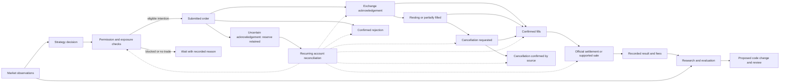

# The business workflow and the next town design

Owner direction, October 16, 2026, 9:44 AM Pacific: complete operating reconciliation before reorganizing the town. PR73 deployed successfully, but the owner rejected its clarity and appearance. Deployment completion is preserved; the product goal is open. This is a source-backed work order, not a claim that this replacement UI exists or that the private operating handoff is complete.

## What the company actually does

Nightcrawler runs independent trading software, practice strategies, research observers and recording infrastructure. Kalshi and Polymarket US are different desks with separate accounts, permissions and results. Codex and assigned development agents improve and investigate the software when given work. The six town characters are display avatars, not six permanently running AI employees.

The current code gives the same character different meanings in different views. The original `CAST3D` maps Voss to the optional Solana judge and Jet to its broker; the town maps them to Kalshi status and orders. A character name cannot identify the service, evidence or money scope. Job and venue labels must come first.

## Company departments

| Department | Question it answers | Actual contents |
| --- | --- | --- |
| Trading | What can trade, and what is it doing now? | Separate Kalshi Bitcoin and Polymarket US desks, their observations, decisions, recurring checks, orders, fills and settlements. |
| Research | What are we testing or observing? | Separate practice twin, strategy arena, other practice desks, forecasts and public-data observers. Each shows its actual stage, result coverage and next step. |
| Records | Where is money committed, and what has settled? | Account cash, reservations, recorded exposure, fees, settled bot results and accounting gaps. Owner activity and operating expenses retain their own scope. |
| Operations | Are the services and data sources working? | Bot, separate recorder, feeds, storage/recovery and schedules, each with dated evidence and explicit missing checks. |
| Engineering | What is the team improving or blocked on? | Existing task IDs, assigned workers, changes, review, tests, release and runtime verification. Queued work is not a running job. |

The private company inventory remains in the existing private vault. Only an explicitly sanitized registry may enter the bot app; private contacts, other-project account details and handoff Part2 must not be copied into this public repository.

## Selected-desk workflow

This is a relationship diagram. It is not an animation of employees passing a trade or a guarantee that every order fills.



Safeguards, freshness checks, cancellation and reconciliation repeat throughout the lifecycle. A cancellation request does not confirm removal of liability. A partial fill can leave holdings and a remaining order. Protected pairs can retain capital even when directional risk is zero. An ended market without reconciled settlement is unresolved, not assumed profit. Research does not automatically promote a strategy or increase real-money limits.

## Actual runtime versus page evidence

| Component | Actual execution/source | Page boundary |
| --- | --- | --- |
| Bitcoin speed desk and real companion | `engine.py` starts a thread; `speeddesk.py` runs feed, practice and live-controller tasks. `speeddesk_live.py` reserves and journals intentions, sends, cancels and reconciles. `speeddesk_live_model.py` owns real inventory/accounting. | `money.speeddesk` contains practice data and a separate `kalshi_live` projection. Top-level page `mode` is not the whole company's mode. |
| Polymarket US desk | Its own thread and state; venue account data includes the owner's own activity. | `money.polymarket` and `money.connections.polymarket_us`; keep owner and bot records distinct. |
| Kalshi arena/learning | Separate practice child process receiving bounded feed frames. Learning is advisory/observation only. | `kalshi_arena`; do not substitute the top-level memecoin `learning` card for Kalshi learning. |
| Practice and observers | Independent trend, follow, coin and observer modules; source existence is not current execution proof. | Separate money/practice keys and watcher keys with their own times. Static research summaries are not running workers. |
| Dedicated Kalshi recorder | Separate deployment/volume, deployed source a0782b74; public GET recording without account/order calls. | No current dedicated recorder key exists in `/api/page`. Online service status alone is not verified capture/storage evidence. |
| Engineering and schedules | Existing coordination/worklog/commitments; separate scheduler invocation metadata. | No live developer heartbeat or complete scheduler registry is currently supplied to the page. Do not invent one from a browser refresh. |

Source review: app b3ca7b76/PR73, `engine.py`, `speeddesk.py`, `speeddesk_live.py`, `speeddesk_live_model.py`, `pagestate.py`, `moneyconnections.py`, `office3d.py` and `worldtycoon_connections.py`. Recorder architecture was separately checked at deployed a0782b74, `kalshi_recorder.py` blob e7ab5cc2. Current runtime evidence must retain its original timestamp; these versions do not guarantee future state.

### Reconciliation with the October16 Claude addendum

The complete [addendum](HANDOFF_ADDENDUM_2026-10-16.md) at8e97efc7 supplies new operating testimony. Preserve its text and apply these source/evidence distinctions:

- Kalshi is the primary displayed desk. Polymarket US also has verified LIVE startup, with separate actual result evidence; neither live mode alone nor a character proves current fills.
- Current fair-value code includes the settlement-average adjustment (`t_eff = t - 39.5s` when `t >= 60s`), not merely the addendum's raw time-to-expiry formula. It is a model approximation, not an exact settlement-index probability.
- Guard checks repeat before and during the order lifecycle. A durable stop survives an ordinary restart; it is not equivalent to lifetime settled P&L or an assertion that no separately authorized future resume is possible. Pair-completion exceptions and account-stale waits require their actual status.
- The practice twin is an intended comparator, not proof of executable fills or a clean causal A/B experiment. Public-wallet and weather observers collect data; they are not automatically simulated trading desks. Each service needs its own execution kind and mode.
- Several native status fields and decision/reconciliation timestamps are absent from the page. The addendum's proposed stage numbers are not all implemented telemetry.
- The recorder checkpoint report is complete, but its raw-volume Phase0 feasibility is not. Sampled growth was about0.313GB/day over saved endpoints, not a verified1GB/day; near-full RAM is distinct from disk. October20 TRAIN is conditional on the preregistered prerequisites, not an automatic start. Do not resize or consume TEST from this map.
- The addendum reports an external cap change. Native9:55–9:56AM reports corroborate20/window,40/open,12/day,10/total,clip5 on restart5903792c/source7d2844c7 (samePR73 app). Those are dated observations, not new defaults or authority to change them. Cash/results, UTC-day reports and reset-aware loss allowance stay separately labeled; the addendum's different UTC result is not reconciled by a sampled status alone.

Claude now reports on-request assistance; Codex owns integration and operating records. External routines require actual runner, last-run and control evidence. Other automation exists outside the bot, so a single reported Claude routine is not a complete business scheduler inventory.

## Missing information that the design must expose honestly

- Native Kalshi status already reports daily stop, pair protection, eligible exchange-index cash and create-order cooldown, but the page's whitelist does not forward all of these. Add only bounded, sanitized fields needed to explain actual behavior.
- Detailed recent decisions are not fully supplied to the town. A fresh status timestamp is not proof of a recent decision. Show “Decision detail not recorded” until a real producer receipt exists.
- Last successful account reconciliation is not persisted as an authoritative page field. Do not substitute page age, report age or balance time.
- The recorder, host recovery, external routines and development queue need their own read-only evidence sources. Do not add synchronous provider/account queries to page rendering.
- A lifecycle needs reliable order/fill/settlement identity joins. Without one, show separate receipts; never combine unrelated latest events into a fictitious trade.

For each service retain stable ID, purpose, venue, execution kind, real/practice/observation scope, source version, original evidence time, freshness, actual action/reason, missing evidence and existing task/next step. Keep operational status separate from a task's status. Any new producer work needs a separate scoped review; this document does not add trading decisions or change risk.

## Phone layout and behavior

Show business purpose before decorative names. A building tap opens a readable explanation, not merely a camera move. Both trading venues and any supported blocking issue are visible from the company view; no extra maze of old controls.

```text
Nightcrawler — your automated trading business
Page received [age]        [individual source ages below]

[Trading] [Research] [Operations] [Work]
[Supported issue, if one exists]

Kalshi Bitcoin       [actual effective mode]  >
Polymarket US        [actual effective mode]  >

[Tycoon town with department/job labels]

Selected department: Trading / Kalshi Bitcoin
What it does: [one sentence]
Now: [actual action or waiting reason]
Desk report [age]   Account checked [known time/unknown]
Cash | Reserved | Recorded exposure | Settled result

Markets → Decision/checks → Orders/fills → Results
[tap for purpose, latest evidence and missing evidence]

Latest receipt [venue, kind, time]
Next work [existing task, actual state, next step]
```

Use at least14px for essential status text and44px tap targets at320/390px widths. Permit normal scrolling. Give the map roughly240–300px initially instead of shrinking meaningful text between fixed overlays. Keep the tycoon world and futuristic direction, with characters as optional guides and names secondary to jobs. No decorative movement establishes work, successful execution or profit.

## Implementation and completion order

1. Complete the existing operating-handoff acceptance rows, or obtain an explicit owner disposition for a genuinely unavailable dormant item. Missing access is not cleared. TJR stays last; existing trading/recorder obligations stay open.
2. Freeze the supported service inventory and data contract. Include unavailable services as unknown/dormant without activating them. Keep private inventory out of public code.
3. Build a plain-text company view using existing authoritative projections, then connect the same view model to the town. `/summary` and the town must agree.
4. Add the minimum read-only telemetry needed for truthful explanations, with source time, scope and bounds. Preserve fees, all losses, UTC/Pacific distinctions, owner/bot separation, partial coverage, stale/auth-clear and no-replay behavior.
5. Validate live/idle, stopped with exposure, pairs-only, stale account, accounting block, partial fill, cancel pending, unknown decision, incomplete results and developer work awaiting runtime proof. Run required code checks and verify the exact authorized deployment.
6. An unfamiliar phone user must be able to explain what runs, what each department does, what is blocked, what settled and what happens next without opening Help. A tested release alone is not evidence that this product goal is met.

This work order is the next town organization task under CODEX-TAKEOVER-001. It does not deploy UI, clear the full handoff, remove safeguards, change variables, activate a desk or raise limits.
